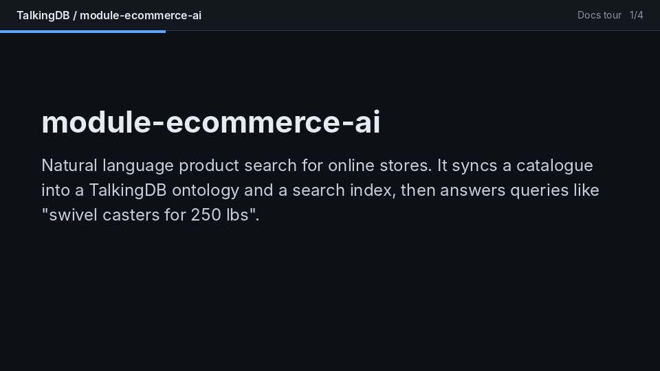

# module-ecommerce-ai

Natural language product search for online stores. It syncs a store's catalogue into a TalkingDB ontology and a search index, then answers shopper queries such as "swivel casters for 250 lbs" by filtering the [knowledge graph](https://en.wikipedia.org/wiki/Knowledge_graph) when it understands the query, and falling back to text search when it does not.


<p align="center">
  
</p>
<p align="center"><sub>A short tour: what it is, how to start, and what to read next.</sub></p>

| Start here | Go deeper |
| :--- | :--- |
| [Two path search](#two-path-search) | [Architecture: sync and search in detail](docs/architecture.md) |
| [Where this fits](#where-this-fits) | [Usage and examples: tenants, sync, crawl, search](docs/usage-and-examples.md) |
| [Quickstart](#quickstart) | [Troubleshooting](docs/troubleshooting.md) |
| [What this repo is not](#what-this-repo-is-not) | [Tenants](#tenants) |

All pages: [docs/](docs/README.md).

This module composes [package-parse-tree](https://github.com/TalkingDB/package-parse-tree) (ontology), [package-search-trainer](https://github.com/TalkingDB/package-search-trainer) (web crawling) and [package-document-search](https://github.com/TalkingDB/package-document-search) (vector and keyword search) through their client interfaces. It serves any store operator; nothing in the code is specific to one store.

## Where this fits

<picture>
  <source media="(prefers-color-scheme: dark)" srcset="docs/images/where-module-ecommerce-ai-fits-dark.svg">
  
</picture>

<sub>Diagram source: [where-module-ecommerce-ai-fits.mmd](docs/diagrams/where-module-ecommerce-ai-fits.mmd). Edit it and re-render with the steps in [docs/diagrams](docs/diagrams/README.md).</sub>

In words: this module owns the shop specific parts (catalogue connector, product ontology, units) and delegates understanding to parse-tree and recall to document search.

## Two path search

<picture>
  <source media="(prefers-color-scheme: dark)" srcset="docs/images/two-path-search-dark.svg">
  
</picture>

<sub>Diagram source: [two-path-search.mmd](docs/diagrams/two-path-search.mmd). Edit it and re-render with the steps in [docs/diagrams](docs/diagrams/README.md).</sub>

In words: if the query names a category the ontology knows, the answer comes from the knowledge graph and can be explained; otherwise text search catches it. Exact, product type, feature and compatibility queries tend to take the first path; thematic, slang and symptom queries tend to take the second.

> [!NOTE]
> Today only the category narrows the graph filter. A resolved attribute value such as "red" or "swivel" does not, because parse-tree's filter follows a fixed allowlist of edges. Extending that filter is the follow up.

## Quickstart

You need Python 3.12 or 3.13, [Poetry](https://python-poetry.org/docs/#installation), the `base-tdb-*` and `package-*` repositories it pins checked out next to this one, a running [package-named-entity-linker](https://github.com/TalkingDB/package-named-entity-linker), Milvus or Milvus Lite, and an `OPENAI_API_KEY` for [embeddings](https://en.wikipedia.org/wiki/Word_embedding).

```bash
make sync MODE=git      # or MODE=local for editable base-tdb-*/package-* checkouts
poetry install
make test
make local              # API on http://localhost:8096, Swagger at /docs
```

## Tenants

A **tenant** is one store. [`tenants.json`](tenants.json) holds each tenant's non secret settings: its namespace, store API URL and unit of measure per attribute. Store credentials come from two environment variables per tenant, read at call time and never stored in the file:

```text
<TENANT_ID in upper case>_STORE_API_UN
<TENANT_ID in upper case>_STORE_API_PWD
```

Adding a tenant is a new JSON entry plus those two variables. Point at a different file with `EAI_TENANTS_CONFIG_PATH`. Full example in [docs/usage-and-examples.md](docs/usage-and-examples.md#add-a-tenant).

## What this repo is not

- **Not a store platform.** It reads a catalogue through the WooCommerce [REST API](https://developer.mozilla.org/en-US/docs/Glossary/REST); it does not sell, price or stock anything.
- **Not a general web search.** It searches one tenant's catalogue and any pages you crawl into that tenant.
- **Not an ontology editor.** It writes a fixed product ontology shape (categories, attribute classes, attribute values, products) into parse-tree.
- **Not self training for NEL.** `/sync` writes ontology data but does not train the Named Entity Linker; see [troubleshooting](docs/troubleshooting.md).

## Related repositories

| Repository | Relationship |
| :--- | :--- |
| [package-parse-tree](https://github.com/TalkingDB/package-parse-tree) | Understands the query and filters the knowledge graph |
| [package-document-search](https://github.com/TalkingDB/package-document-search) | Fallback vector and keyword search |
| [package-search-trainer](https://github.com/TalkingDB/package-search-trainer) | Crawls buying guides and other pages into the tenant's index |
| [package-named-entity-linker](https://github.com/TalkingDB/package-named-entity-linker) | Called by parse-tree to find known words in the query |
| [talkingdb-benchmarks](https://github.com/TalkingDB/talkingdb-benchmarks) | Public retrieval benchmarks, including an ecommerce support case |

## Further reading

- [WooCommerce REST API](https://woocommerce.github.io/woocommerce-rest-api-docs/)
- [Ontology (information science)](https://en.wikipedia.org/wiki/Ontology_(information_science))
- [Hybrid search explained (Weaviate blog)](https://weaviate.io/blog/hybrid-search-explained)

## Support TalkingDB

If module-ecommerce-ai saved you time, please [give it a star](https://github.com/TalkingDB/module-ecommerce-ai) ⭐. Stars help other developers find the project.

Found a bug, or a document it gets wrong? [Open an issue](https://github.com/TalkingDB/module-ecommerce-ai/issues/new). We are always here to help and open to a conversation. Explore the TalkingDB applications at [talkingdb.io](https://talkingdb.io/#applications).

## License

> [!NOTE]
> This repository does not have a LICENSE file yet. Most TalkingDB repositories are licensed under [AGPL-3.0](https://www.gnu.org/licenses/agpl-3.0.html); until a LICENSE file is added here, no license is granted by this README.
