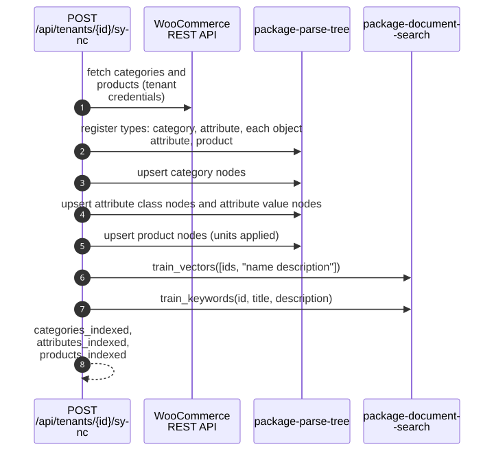

# Architecture

[Docs home](README.md) › Architecture

What module-ecommerce-ai owns, how a catalogue sync builds the [ontology](https://en.wikipedia.org/wiki/Ontology_(information_science)) and index, and how a search chooses its path. For setup, start at the [README](../README.md).

## What this module owns

Everything that is ecommerce vocabulary lives here, so the `package-*` repositories stay domain agnostic:

| Part | Code |
| :--- | :--- |
| The product ontology: category, attribute class, one type per object attribute, product | [`services/ontology/types.py`](../talkingdb_eai/services/ontology/types.py), [`services/ontology/product.py`](../talkingdb_eai/services/ontology/product.py) |
| The WooCommerce connector, configured per tenant | [`services/connectors/woocommerce.py`](../talkingdb_eai/services/connectors/woocommerce.py) |
| Tenant settings and credentials lookup | [`services/tenants/config.py`](../talkingdb_eai/services/tenants/config.py), [`tenants.json`](../tenants.json) |
| Catalogue sync | [`services/ingest/orchestrator.py`](../talkingdb_eai/services/ingest/orchestrator.py) |
| Two path search | [`services/search/orchestrator.py`](../talkingdb_eai/services/search/orchestrator.py) |
| Unit formatting per tenant | [`services/units.py`](../talkingdb_eai/services/units.py) |

## Catalogue sync

<picture>
  <source media="(prefers-color-scheme: dark)" srcset="images/what-post-sync-does-dark.svg">
  
</picture>

<sub>Diagram source: [what-post-sync-does.mmd](diagrams/what-post-sync-does.mmd). Edit it and re-render with the steps in [docs/diagrams](diagrams/README.md).</sub>

In words: sync reads the store, writes its structure into the ontology and its text into the search index, and reports how much it wrote. Running it again upserts the same data.

> [!IMPORTANT]
> Sync does not train the Named Entity Linker. Until parse-tree's `POST /api/namespaces/{namespace}/ner/train` runs for the tenant's namespace, product and category names are not recognised in queries, and every search falls back to text search.

The target namespace in package-document-search must already exist, with `embedding` as the vector field and a `title` field for keyword search.

### Object attributes

`object_attributes` in the sync request names product attributes that should become graph nodes rather than plain text, and whether each can hold many values:

```json
{"object_attributes": {"wheel_type": false, "mounting": true}}
```

Each becomes its own ontology type, every distinct value becomes a node, and each product links to its values through a `REF` (one) or `[REF]` (many) edge.

## Search

`POST /api/tenants/{tenant_id}/search` runs the two path search drawn in the [README](reference.md#two-path-search):

1. `PTClient.extract_relations(namespace, query)` parses the query.
2. Each resolved category becomes a filter `instance_of = <category id>`.
3. If there are filters and the [knowledge graph](https://en.wikipedia.org/wiki/Knowledge_graph) returns rows, those rows are the answer.
4. Otherwise `DSClient.search` runs with `vector_field="embedding"` and `keyword_field="title"`.
5. The tenant's units are applied to every result.

`extract_relations` returns pydantic models in direct mode and plain JSON in API mode; the orchestrator turns both into plain dictionaries, so either client mode works.

## Units

`apply_unit` adds the tenant's unit to a value that starts with a number and leaves everything else alone. A real run on 25 November 2026 against commit `559e07e`:

```python
from talkingdb_eai.services.units import apply_units

apply_units(
    {
        "capacity": "250",
        "wheel_diameter": "4.5 inches",
        "color": "red",
        "tread": "soft",
    },
    {"capacity": "lbs", "wheel_diameter": "in", "tread": "mm"},
)
# {'capacity': '250 lbs', 'wheel_diameter': '4.5 in', 'color': 'red', 'tread': 'soft'}
```

Note that `"4.5 inches"` became `"4.5 in"`: only the leading number is kept, then the configured unit is added.

## Dependencies

As of 25 November 2026 this repository pins `base-tdb-models` at `6ad6e83`, `base-tdb-clients` at `29abea2`, `base-tdb-helpers` at `d7c891b`, `package-parse-tree` at `1ea5b70`, `package-document-search` at `e571768` and `package-search-trainer` at `cfd2b44`.

---

**Related:** [Troubleshooting](troubleshooting.md) · [Usage and examples](usage-and-examples.md) · [README](../README.md)
